  

  
  
  

 

## 🚀 About me

I’m **Zaid**, a developer from India building polished, practical web experiences. I enjoy turning ideas into responsive full-stack products, exploring security, and growing through open source.

- **Latest launch:** [Venn Spoke](https://github.com/Cyberbadfit/Venn-Spoke) — a responsive React e-commerce storefront, now live on Vercel.
- **Working with:** modern JavaScript, responsive UI engineering, APIs, databases, and developer tooling.
- **Always exploring:** application security, better UX, and solutions that are as usable as they are well engineered.

  

## 🛠️ Engineering toolkit

  

## ✨ Selected work

<table>
  <tr>
    <td width="50%" valign="top">
      <h3>⚡ Nexus Hackathon 2026</h3>
      
Official hackathon website for SRM Institute of Science and Technology, designed around multiple innovation tracks and a clear participant journey.

      
<a href="https://github.com/Cyberbadfit/Nexus-Hackathon-2026">Explore repository →</a> · <a href="https://nexus-hackathon-2026-three.vercel.app">Live site →</a>

    </td>
    <td width="50%" valign="top">
      <h3>🧩 Full-Stack Web Projects</h3>
      
A practical collection of modern web applications focused on responsive interfaces, API integration, databases, and real product functionality.

      
<a href="https://github.com/Cyberbadfit/Full-Stack-Web-Development-Projects">Explore repository →</a>

    </td>
  </tr>
  <tr>
    <td width="50%" valign="top">
      <h3>📐 Responsive Frontend</h3>
      
Frontend work centered on layouts that feel deliberate and consistent across mobile, tablet, and desktop screens.

      
<a href="https://github.com/Cyberbadfit/Responsive-frontend-web-development">Explore repository →</a>

    </td>
    <td width="50%" valign="top">
      <h3>🔧 C Language Programs</h3>
      
Focused C exercises covering fundamentals such as control flow, functions, arrays, pointers, and problem solving.

      
<a href="https://github.com/Cyberbadfit/C-Language-Programs">Explore repository →</a>

    </td>
  </tr>
</table>

## 📌 Current project status

<table>
  <tr>
    <td width="58%" valign="top">
      <h3>🛍️ Venn Spoke </h3>
      
A polished React + TypeScript storefront with 34 demo products, responsive layouts, animated cart interactions, INR checkout, a test UPI QR flow, order tracking, and an operations dashboard.

      
<strong>Note:</strong> Payments are clearly simulated for safe testing—no real money is collected.

      
<a href="https://github.com/Cyberbadfit/Venn-Spoke">View source →</a> · <a href="https://vennspoken.vercel.app/">Open live demo →</a>

    </td>
    <td width="42%" valign="top">
      <h4>Release checklist</h4>
      <ul>
        <li>✅ Vercel deployment online</li>
        <li>✅ GitHub Pages build configured</li>
        <li>✅ Mobile, tablet, and desktop UI</li>
        <li>🛠️ Production database hardening in progress</li>
      </ul>
    </td>
  </tr>
</table>

## 📊 GitHub activity

  
  

  

## 🤝 Let’s connect

  
  
  

 

Designed with intent · Built in public · Open to meaningful collaboration

